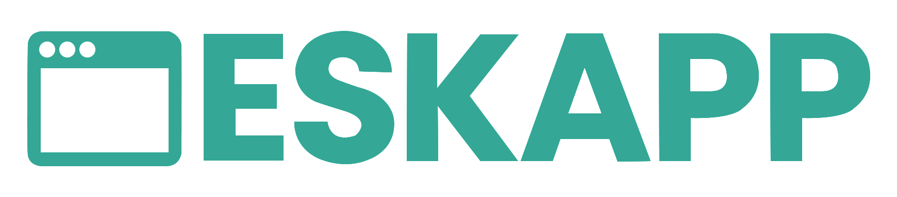

<p align="center">
  <a href="https://github.com/niyamulahsan/deskapp">
    
  </a>
</p>

<p align="center">
  
</p>

<p align="center">
  <a href="https://niyamulahsan.github.io/deskapp"></a>
  <a href="https://www.npmjs.com/package/@niyamulahsan/create-deskapp"></a>
  <a href="https://www.npmjs.com/package/@niyamulahsan/create-deskapp"></a>
  <a href="https://github.com/niyamulahsan/deskapp/blob/main/LICENSE"></a>
  <a href="https://github.com/niyamulahsan/deskapp"></a>
</p>

# Deskapp

Deskapp is a desktop application framework built on **Electron + Vue 3** with TypeScript. It provides a complete, opinionated starting point for building cross-platform desktop apps with native windows, IPC bindings, SQLite/Drizzle, queues, schedulers, and more.

## Quick Start

```bash
npm create @niyamulahsan/deskapp@latest my-app
cd my-app
npm install
npm run dev
```

A desktop window opens with the starter dashboard, backed by the full local stack (SQLite, queue, cron, storage, Playwright) exposed through bindings.

## Features

| Category         | What you get                                                                                                                |
| ---------------- | --------------------------------------------------------------------------------------------------------------------------- |
| **Windows**      | Window presets, manager, native chrome, dialogs via `win`/`chrome`                                                          |
| **Bindings**     | Backend controllers auto-registered and callable from the UI via IPC as `md.module.controller.handler()` or `bindings[...]` |
| **Storage**      | App-managed storage (private/tmp) and file utilities                                                                        |
| **Database**     | SQLite + Drizzle ORM, generated schema and migrations                                                                       |
| **Queue**        | In-process job queue                                                                                                        |
| **Scheduler**    | Cron-based task scheduling with croner                                                                                      |
| **Validation**   | Zod-powered request validation                                                                                              |
| **Security**     | Bcrypt password hashing                                                                                                     |
| **Automation**   | Playwright support for browser automation                                                                                   |
| **UI**           | Vue 3 + Vite with hot reload                                                                                                |
| **CLI**          | Maker commands for modules, controllers, models, migrations                                                                 |
| **Distribution** | Package with electron-builder for Windows, macOS, and Linux                                                                 |

## Architecture

```
src/
├── main.ts            # Electron main process entrypoint
├── preload.ts         # Preload script exposing bindings
├── core/              # Framework: facade, bindings, database, queue,
│                      # scheduler, storage, validation, password, playwright,
│                      # maker CLI
├── modules/           # Application modules (auto-discovered)
├── database/          # Generated schema + SQLite migrations
├── storage/           # App-managed data (private, tmp) - gitignored
├── ui/                # Vue 3 + Vite frontend (renderer)
├── window/            # Window presets, manager, native chrome, dialogs
└── icons/             # App icons
```

## Documentation

Full documentation is available in [packages/docs](./packages/docs) or online at the docs site.

## Contributing

Contributions are welcome. Open an issue or pull request on [GitHub](https://github.com/niyamulahsan/deskapp).

## Donate

If Deskapp helps you build faster, consider supporting the project:

<p>
  <a href="https://www.supportkori.com/niyam" target="_blank">
    
  </a>
  <a href="./DONATE.md#-international-bank-transfer">
    
  </a>
</p>

See [DONATE.md](./DONATE.md) for full details (bKash, Nagad, Support Kori, and SWIFT/BIC).

## License

[MIT](./LICENSE)
