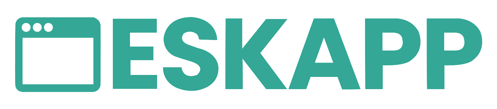

<p align="center">
  <a href="https://github.com/niyamulahsan/deskapp">
    
  </a>
</p>

<p align="center">
  <a href="https://niyamulahsan.github.io/deskapp"></a>
  <a href="https://www.npmjs.com/package/@niyamulahsan/create-deskapp"></a>
  <a href="https://www.npmjs.com/package/@niyamulahsan/create-deskapp"></a>
  <a href="https://github.com/niyamulahsan/deskapp/blob/main/LICENSE"></a>
  <a href="https://github.com/niyamulahsan/deskapp"></a>
</p>

# @niyamulahsan/create-deskapp

Scaffold a new Deskapp project with Electron + Vue 3 + npm.

## Usage

```bash
npm create @niyamulahsan/deskapp@latest my-app
# or
npx @niyamulahsan/create-deskapp my-app
```

Then:

```bash
cd my-app
npm install
npm run dev
```

## Features

- Electron main process + Vue 3 renderer
- IPC bindings for in-process backend/frontend communication
- SQLite + Drizzle ORM
- Queue, scheduler, storage utilities
- Native windows, menus, dialogs, file pickers
- Playwright support for automation
- Hot reload in development
- Package with electron-builder

## Documentation

See the [main repository](https://github.com/niyamulahsan/deskapp) for full documentation.

## Contributing

Contributions are welcome. Open an issue or pull request on [GitHub](https://github.com/niyamulahsan/deskapp).

## License

[MIT](./LICENSE)